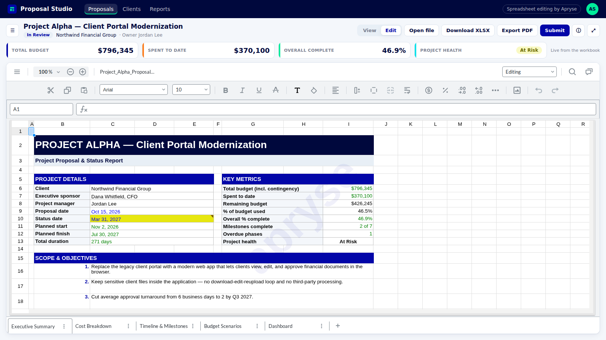

# Proposal Studio — Excel editing in a React app with Apryse Spreadsheet Editor

**Proposal Studio** is a small demo portal for planning project proposals. It shows how to embed **Apryse Spreadsheet Editor** (part of the Apryse WebViewer SDK) in a **React + Vite + TypeScript** app. Users open a real multi-sheet **XLSX** workbook, edit cells, formulas and formatting, and save it back to **XLSX** or **PDF**. All of this happens **in the browser**, with no server-side processing.



- **Stack:** React 18, Vite 7, TypeScript 5, `@pdftron/webviewer` 12.2.1 (Apryse used to be called PDFTron)
- **Sample file:** `public/files/Project_Alpha_Proposal_Clean.xlsx`, a fictional 5-sheet proposal with cross-sheet formulas, merged cells and five Excel charts
- **Key idea:** the portal and the spreadsheet share one source of truth. The KPI cards above the editor are read live from workbook cells with the Workbook API, so they update as soon as you edit the spreadsheet.

---

## Watch it

Check out videos about Spreadsheet Editor and more at the Apryse YouTube Channel https://www.youtube.com/@apryse-solutions/

## Quick start

```bash
# 1. Install. A postinstall script copies WebViewer's static files to public/lib/webviewer
npm install

# 2. Add your Apryse trial or license key
cp .env.example .env          # then paste your key after VITE_APRYSE_LICENSE_KEY=

# 3. Run
npm run dev                   # opens http://localhost:5173
```

**Starting a brand-new project instead?** Apryse's CLI scaffolds a React, Angular or Vue WebViewer app and writes your key into `.env`:

```bash
npx @apryse/create-webviewer-app my-app --key YOUR_TRIAL_KEY
```

Then apply the three spreadsheet settings shown below.

---

## How it works

### 1. Turn WebViewer into a spreadsheet editor (three settings)

`src/hooks/useSpreadsheetEditor.ts`

```ts
import WebViewer from "@pdftron/webviewer";

WebViewer(
  {
    path: "/lib/webviewer", // static files copied on install
    licenseKey: import.meta.env.VITE_APRYSE_LICENSE_KEY,
    initialDoc: "/files/Project_Alpha_Proposal_Clean.xlsx",
    initialMode: WebViewer.Modes.SPREADSHEET_EDITOR, // 1. spreadsheet UI instead of the PDF viewer
    enableOfficeEditing: true, // 2. allow editing Office formats
    spreadsheetEditorOptions: {
      initialEditMode: WebViewer.InitialEditModes.EDITING, // 3. open in editing mode (default is view-only)
    },
  },
  viewerElement, // a <div> with an explicit height
);
```

### 2. Wait for the workbook, then use the API

To perform programmatic actions, listen for the `spreadsheetEditorReady` event.

Spreadsheet Editor events enable your application to respond to changes and user interactions within the Spreadsheet Editor. Subscribe to these events to implement custom workflows, synchronize application state, validate data, and extend the editor experience.

```ts
const { documentViewer, SpreadsheetEditor } = instance.Core;
const manager = documentViewer.getSpreadsheetEditorManager();
const Events = SpreadsheetEditor.SpreadsheetEditorManager.Events;

manager.addEventListener(Events.SPREADSHEET_EDITOR_READY, () => {
  // The workbook is loaded in memory. Safe to read or change cells now.
});

manager.addEventListener(Events.DATA_CHANGED, () => {
  // A value, style or range changed. Formulas have recalculated.
});
```

### 3. Read a cell (zero-based indexes)

```ts
const workbook = manager.getWorkbook();
const sheet = workbook.getSheet("Executive Summary");
const cell = sheet.getCellAt(5, 8); // Excel I6 -> row 5, column 8
const text = cell.getDisplayStringValue(); // "$796,345": the formatted value shown in the grid
```

### 4. Switch between view-only and editing

```ts
manager.setEditMode(SpreadsheetEditor.SpreadsheetEditorEditMode.VIEW_ONLY); // reviewers
manager.setEditMode(SpreadsheetEditor.SpreadsheetEditorEditMode.EDITING); // authors
```

### 5. Save as XLSX or export to PDF

```ts
instance.UI.downloadPdf({
  downloadType: "spreadsheetEditor",
  filename: "proposal.xlsx",
}); // XLSX
instance.UI.downloadPdf({ downloadType: "pdf", filename: "proposal.pdf" }); // PDF
```

### 6. Open a file from the user's computer (nothing is uploaded)

```ts
instance.UI.loadDocument(file, {
  filename: file.name,
  extension: "xlsx",
  enableOfficeEditing: true,
});
```

All six helpers live in `src/lib/spreadsheet.ts`. They are framework-free, so you can copy them into Angular, Vue or plain JavaScript.

---

## Project structure

```
proposal-studio/
├─ index.html
├─ package.json                     postinstall copies WebViewer assets
├─ .env.example                     VITE_APRYSE_LICENSE_KEY=
├─ scripts/
│  └─copy-webviewer-assets.mjs     node_modules/@pdftron/webviewer/public -> public/lib/webviewer
├─ public/
│  ├─ files/                        sample XLSX workbooks
│  └─ lib/webviewer/                WebViewer static files (generated, git-ignored)
├─ src/
│  ├─ config.ts                     license key, asset path, sample file, KPI cell map
│  ├─ lib/spreadsheet.ts            Spreadsheet Editor helpers: mode, read cells, export, open file
│  ├─ hooks/useSpreadsheetEditor.ts mounts WebViewer and exposes ready / editing / kpis
│  ├─ components/                   TopBar, ProposalSidebar, ProposalHeader, KpiStrip, DetailsPanel
│  ├─ data/proposals.ts             fictional sidebar, approver and activity data
│  ├─ App.tsx                       layout
│  └─ styles.css                    Apryse brand colors as CSS variables
└─ docs/
   ├─ screenshot.png
```

---

## The sample workbook

`Project_Alpha_Proposal_Clean.xlsx` is a fictional proposal for "Northwind Financial Group." All names and numbers are made up.

| Sheet                 | What it contains                                                                                                                                   |
| --------------------- | -------------------------------------------------------------------------------------------------------------------------------------------------- |
| Executive Summary     | Project details, key metrics pulled from other sheets, a health status formula, objectives, budget snapshot, approvals                             |
| Cost Breakdown        | 14 line items (qty × unit cost), subtotal, 10% contingency, category totals (SUMIFS), monthly spend plan with cumulative totals                    |
| Timeline & Milestones | 7 phases with duration, NETWORKDAYS, % complete, status formula, duration-weighted overall progress; 7 milestones with days-to-due                 |
| Budget Scenarios      | What-if table (Lean / Base / Expanded) with blue inputs for labor adjustment and contingency, plus a stacked column chart that redraws as you edit |
| Dashboard             | 4 KPI tiles plus 4 native charts: clustered column, doughnut, line, horizontal bar                                                                 |

**Try these edits:** on _Budget Scenarios_, change Expanded's labor adjustment (C8) from +15% to +40%, and the chart redraws immediately. Then on _Timeline & Milestones_, change UX/UI Design from 95% to 100%. The phase becomes Complete, the overdue count drops to 0, and _Project health_ on the Executive Summary (and the KPI card above the editor) flips from **At Risk** to **On Track**.

---

## FAQ

**How do I add Excel editing to a React app?**
Install `@pdftron/webviewer`, copy its `public` folder into your app's static files, and initialize WebViewer with `initialMode: WebViewer.Modes.SPREADSHEET_EDITOR` and `enableOfficeEditing: true`. See `src/hooks/useSpreadsheetEditor.ts`.

**Does the spreadsheet get uploaded to a server?**
No. WebViewer opens, edits, recalculates and saves the file in the browser. The app's own dev server only serves the static sample file and WebViewer's assets. A file opened with "Open file" is read locally and never sent anywhere. You can confirm this in the DevTools Network tab.

**How do I make the spreadsheet read-only for some users?**
Call `manager.setEditMode(SpreadsheetEditorEditMode.VIEW_ONLY)`, or start that way with `spreadsheetEditorOptions: { initialEditMode: 'viewOnly' }`.

**How do I know when the user changed something?**
Listen for `SpreadsheetEditorManager.Events.DATA_CHANGED`.

**How do I read a calculated value?**
`workbook.getSheet(name).getCellAt(row, col).getDisplayStringValue()`. Indexes are zero-based.

**How do I save the edited workbook?**
`instance.UI.downloadPdf({ downloadType: 'spreadsheetEditor' })` saves XLSX. Use `downloadType: 'pdf'` for PDF.

**Which file types can users open?**
XLSX, XLS and CSV.

**Can I use this with Angular or Vue?**
Yes. The WebViewer options and `src/lib/spreadsheet.ts` are framework-independent. The CLI (`npx @apryse/create-webviewer-app`) can scaffold Angular and Vue projects.

**Why is my React component creating two viewers?**
React StrictMode runs effects twice in development. The hook uses a ref guard (`started`) so WebViewer mounts once.

---

## Notes

- Apryse WebViewer is commercial software. A trial key is free and provides access to all functionality but will include an Apryse watermark. Production use needs a license. See [apryse.com](https://apryse.com).
- Edits live in memory until you download. Reload the page to reset the demo.
